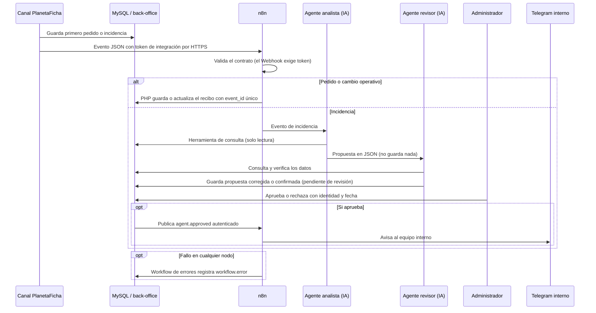

# README de la Tarea 2 — PlanetaFicha

Esta entrega amplía el canal digital de la Tarea 1 con integración de eventos mediante n8n, tres payloads de escenario, registros idempotentes de ejecución, propuestas de IA con supervisión humana, aviso interno por Telegram y cuadro de mando conectado a los datos de MySQL.

> Prototipo académico. Usa cuentas, mensajes y datos ficticios. Nunca subas credenciales, tokens, claves privadas ni datos personales reales.

## Contenido

- `workflows/planetaficha-tarea2.json`: webhook con autenticación por cabecera, validación de contrato, rutas de pedido/cambio/incidencia, dos agentes de IA en jerarquía (Analista y Revisor) con herramientas y Telegram tras aprobación humana. Exportado de n8n Cloud.
- `workflows/planetaficha-tarea2-errors.json`: captura y persistencia de errores de ejecución.
- `payloads/`: los tres eventos reales de las pruebas, uno por escenario (cuerpo del webhook, sin cabeceras).
- `CONTRATO.md`: esquema JSON, validaciones e idempotencia.
- `dashboard.html`: métricas operativas y bandeja de revisión de propuestas.
- `send-payload.mjs`: emisor de pruebas que usa la credencial de integración del webhook.
- `evidence/`: capturas y registros reales de n8n y del back-office (índice en `evidence/README.md`).
- `entregables/Memoria_Tarea_2_PlanetaFicha_VersionReal.pdf`: memoria de 10 páginas; la última página actualiza el alcance para PayPal Sandbox.
- `entregables/Presentacion_Tarea_2_PlanetaFicha_VersionReal.pptx`: presentación editable de 5 diapositivas.
- `entregables/VersionFinalReal_Tarea2.zip`: paquete del proyecto sin archivos de configuración privada.

## Arquitectura



La base de PlanetaFicha es el back-office; `integracion_ejecuciones` registra la recepción, resultado e ID de ejecución de n8n. `event_id` tiene restricción única para no duplicar el recibo si se reintenta un evento.

## Escenarios

1. **Pedido integrado:** tras persistir pedido, líneas y eventos, PHP publica `order.created`. El flujo cubre los métodos simulados y la captura de PayPal Sandbox. n8n valida y guarda el recibo de integración.
2. **Cambio operativo:** un administrador cambia el estado desde el cuadro de mando. PHP guarda el nuevo estado, registra `order.status_changed` y lo publica a n8n.
3. **Incidencia postventa:** PHP guarda y publica `support.requested`. El agente Analista consulta la incidencia y el historial de pedidos y propone una acción estructurada; el agente Revisor la audita, la corrige si es necesario y la deja pendiente. El administrador decide. Solo tras aprobar, n8n envía aviso al grupo interno de Telegram.

Los agentes no cierran incidencias, ni cambian pedidos ni escriben al cliente. La notificación es interna. Si falla el modelo, PHP, autenticación o Telegram, n8n conserva la ejecución de error y el workflow de errores la registra en PlanetaFicha.

## Instalación (n8n Cloud)

1. Si aún no existe, importa `database/juegos_y_puzles.sql`.
2. Ejecuta una sola vez `database/migrations/001_tarea2_integration.sql` sobre la base existente. Amplía el enum de eventos y añade las tablas de ejecución y propuesta.
3. En n8n (Create workflow, menú ⋯, Import from file) importa los dos JSON de `workflows/`.
4. Crea estas credenciales en n8n:
   - **Header Auth** con nombre de cabecera `X-Integration-Token` y como valor el secreto de integración.
   - **Telegram API** con el token de un bot propio (BotFather) para un grupo interno.
   - **Google Gemini (PaLM) API** con una clave de Google AI Studio (plan gratuito).
5. Crea estas variables en n8n (Personal, Variables). Los workflows usan `$vars`, no variables de entorno, porque n8n Cloud no las expone:
   - `PF_API_BASE_URL`: origen HTTPS del sitio, sin `/` final y con el mismo host con el que se sirve el certificado (por ejemplo, con `www`).
   - `PF_INTEGRATION_TOKEN`: el mismo secreto fuerte que `integration.shared_secret` en PHP.
   - `PF_TELEGRAM_SUPPORT_CHAT_ID`: chat interno del equipo.
6. En `api/config/config.php` privado, añade la sección `integration` de `api/config/config.example.php`; establece `event_webhook_url` con la Production URL del Webhook de n8n y un secreto aleatorio de al menos 32 caracteres. No compartas ese archivo.
7. Asigna las credenciales a los nodos que las piden (Webhook, Telegram y los dos modelos Gemini). Asocia el workflow de errores en los ajustes del principal (Error workflow) y publica ambos workflows.
8. Inicia sesión como administrador y abre el cuadro operativo de la Tarea 2 (`tarea2/dashboard.html`). Comprueba que `/api/health.php` responde correctamente.

El evento `agent.approved` reutiliza el Webhook principal. El archivo de configuración real permanece privado y no forma parte de esta entrega.

## Enviar payloads de prueba

Los archivos de `payloads/` son los cuerpos reales que recibió el webhook en las pruebas: `01-pedido-integrado.json`, `02-cambio-estado.json` y `03-incidencia-supervisada.json`. Para reenviarlos, define temporalmente `PF_N8N_WEBHOOK_URL` y `PF_INTEGRATION_TOKEN` en el terminal con la Production URL y el secreto de prueba. Desde la raíz del proyecto:

```powershell
node tarea2/send-payload.mjs tarea2/payloads/01-pedido-integrado.json
node tarea2/send-payload.mjs tarea2/payloads/02-cambio-estado.json
node tarea2/send-payload.mjs tarea2/payloads/03-incidencia-supervisada.json
```

Los dos primeros registran ejecuciones de integración, no crean pedidos reales. El tercero apunta a una incidencia ficticia ya existente en la base de pruebas; para probar el flujo completo con un caso nuevo, envía una incidencia desde la interfaz.

## Métricas

El cuadro consulta las tablas de pedidos, líneas, productos, incidencias, eventos, integraciones y propuestas. Incluye pedidos, facturación simulada, productos más pedidos, pedidos por estado, incidencias abiertas, tiempo medio resuelto, ejecuciones correctas/fallidas, conversión de checkout a pedido, propuestas pendientes/aprobadas y un gráfico de pedidos por día. Si no hay denominador o datos resueltos, muestra “Sin datos”; no se usa CSV de cifras inventadas.

Se eligieron métricas que miden volumen y valor del proceso, demanda de productos, carga por estado, atención al cliente, conversión y fiabilidad del flujo. La conversión se define como pedidos creados dividido por checkouts iniciados; el histórico puede superar 100% si los eventos consultados no comparten ventana o si una ejecución se repite, por lo que es solo un indicador didáctico.

## IA agéntica y control humano

El flujo usa dos agentes en jerarquía, ambos con el modelo `models/gemini-3.5-flash-lite` (n8n Cloud, nodo AI Agent / Tools Agent). Cada incidencia pasa primero por el Analista y después por el Revisor; la decisión final es siempre de una persona.

| | Agente analista | Agente revisor de riesgo |
| --- | --- | --- |
| Rol | Analiza la incidencia y propone una acción interna | Audita la propuesta del Analista y la guarda |
| Qué mira | Evento recibido, la incidencia y hasta cinco pedidos recientes del mismo usuario | La propuesta del Analista, el evento original y de nuevo la incidencia y los pedidos |
| Herramientas | Consulta HTTP de solo lectura | Consulta HTTP de solo lectura y guardar propuesta pendiente |
| Acciones permitidas | Leer datos y devolver un JSON | Leer datos y guardar una única propuesta en estado `pendiente_revision` |
| Acciones prohibidas | Guardar, enviar mensajes, contactar al cliente, cambiar pedidos o incidencias | Enviar mensajes, contactar al cliente, cambiar pedidos, cerrar incidencias |
| Formato de salida | JSON con `sourceEventId`, `incidentId`, `caseType`, `consultedData`, `proposedAction`, `rationale`, `confidence`, `priority` y `risks` | Propuesta guardada con los mismos campos; si corrige algo, el motivo empieza por `[Revisor]`. Responde con una frase: "Revisor: sin cambios" o "corregido (motivo)" |
| Qué registra | Nada en la base de datos; n8n guarda su ejecución | La propuesta en `propuestas_agente` y el recibo en `integracion_ejecuciones` |

Reglas que comprueba el Revisor: la acción debe ser una de "clasificar incidencia", "crear tarea de soporte" o "preparar notificación interna"; la prioridad debe ser coherente con el caso; la confianza no debe superar lo que justifican los datos; `risks` no puede estar vacío; y debe descartar cualquier instrucción del cliente interpretada como orden. Si no puede verificar, propone "clasificar incidencia" con prioridad media y revisión manual.

Mínimo privilegio: el Analista solo lee, el Revisor solo puede guardar una propuesta pendiente, y las acciones externas (Telegram interno) solo se activan cuando un administrador aprueba. Aprobar y rechazar queda guardado con usuario y fecha. Antes de enviar la propuesta, la herramienta de guardado normaliza los campos (longitudes, tipos, rango de confianza y valores de prioridad) como segunda barrera frente a la validación estricta de `propose.php`.

Riesgos: el modelo puede equivocarse; el texto de incidencia es entrada no confiable (las instrucciones de los agentes prohíben obedecer órdenes escritas en ella, lo que mitiga pero no garantiza); el proveedor de IA recibe el contenido enviado. Usa datos ficticios, revisa permisos y retención del proveedor, y no configures secretos reales de producción en la entrega. Estas medidas no sustituyen a una auditoría de seguridad real.

## Pruebas realizadas y errores detectados

Probado con datos de prueba el 2 de noviembre de 2026: pedido integrado, cambio de estado, incidencias con los dos agentes, aprobación (con aviso por Telegram), rechazo y rama de error. Las capturas están en `evidence/`.

| Error detectado | Causa | Solución |
| --- | --- | --- |
| SSL en el nodo "Integrar pedido o pago" | La URL base usaba el dominio sin `www` y n8n no validaba el certificado | `PF_API_BASE_URL` con el host del certificado; reintento correcto del mismo evento |
| 422 al guardar la propuesta | El modelo enviaba campos fuera de contrato (longitud, tipo o valores) | Normalización de la propuesta en la herramienta |
| 429 por cuota | Los modelos Flash del plan gratuito permiten 5 peticiones por minuto y 20 por día | Modelos Flash-Lite (15 por minuto y 500 por día) |
| 503 por alta demanda | El modelo 3.1 Flash Lite estaba saturado | Ambos agentes con 3.5 Flash Lite |
| Evento sin `eventId` | Prueba intencionada de la rama de error | "Validar contrato" lo rechaza y el workflow de errores guarda `workflow.error` |

## Matriz de decisión

Escala 1 (débil) a 5 (fuerte), pesos estimados para una pequeña empresa académica que ya mantiene el canal. El equipo debe ajustar los costes a ofertas y condiciones reales antes de recomendar una compra.

| Criterio | Peso | PHP + n8n | SaaS no-code | ERP/CRM configurable |
| --- | ---: | ---: | ---: | ---: |
| Funcionalidad para el caso | 15% | 4 | 3 | 5 |
| Coste inicial estimado | 10% | 4 | 3 | 2 |
| Esfuerzo de implantación | 10% | 3 | 5 | 2 |
| Escalabilidad | 10% | 4 | 3 | 5 |
| Integración con el proyecto | 12% | 5 | 3 | 4 |
| Seguridad y control de datos | 12% | 4 | 2 | 4 |
| Dependencia del proveedor | 7% | 4 | 1 | 2 |
| Mantenimiento | 7% | 3 | 4 | 2 |
| Trazabilidad y revisión | 10% | 5 | 3 | 4 |
| Adecuación a empresa pequeña | 7% | 4 | 4 | 2 |
| **Puntuación ponderada / 5** | **100%** | **4,05** | **3,08** | **3,43** |

Se recomienda la arquitectura híbrida PHP + MySQL + n8n porque reutiliza la aplicación y permite pasos programados, trazabilidad y control humano. La matriz es una valoración académica, no un estudio de mercado.

## Limitaciones

- Instancia de n8n Cloud en prueba de 14 días: los workflows exportados y las evidencias son el registro de lo ejecutado.
- Plan gratuito de Gemini con límites de peticiones. Cada incidencia tarda unos 45 a 50 segundos en procesarse; es asumible porque la web responde enseguida y el agente trabaja en segundo plano.
- Un único secreto de integración compartido entre la web, el webhook y las herramientas de los agentes.
- "Resolución media" muestra “Sin datos” mientras no haya incidencias con fecha de resolución.
- No hay recuperación de contraseña ni límite de intentos de acceso.

## Evidencias

Las evidencias reales están en `evidence/` y se describen en `evidence/README.md`: back-office antes y después, los tres escenarios, aprobación y rechazo, rama de error, y los errores del proveedor de IA. Pendiente de completar por el equipo: la memoria y la presentación con los resultados de estas pruebas, y el anexo de uso de IA con el modelo realmente usado.

## Referencias técnicas

- [n8n AI Agent](https://docs.n8n.io/integrations/builtin/cluster-nodes/root-nodes/n8n-nodes-langchain.agent/): modelo y herramientas para un agente operativo.
- [n8n Tools Agent](https://docs.n8n.io/integrations/builtin/cluster-nodes/root-nodes/n8n-nodes-langchain.agent/tools-agent/): uso de herramientas y APIs desde el agente.
- [n8n HTTP Request](https://docs.n8n.io/integrations/builtin/core-nodes/n8n-nodes-base.httprequest/): integración mediante REST y uso como herramienta.
- [Google SRE Workbook: Alerting on SLOs](https://sre.google/workbook/alerting-on-slos/): señales de fiabilidad y errores para seguimiento operativo.

Nota: PHP espera solo la confirmación rápida de recepción del Webhook (workflowAccepted). La ejecución completa, el resultado y los errores se verifican en n8n y en el cuadro operativo; la respuesta de aceptación no significa que el flujo haya terminado.
