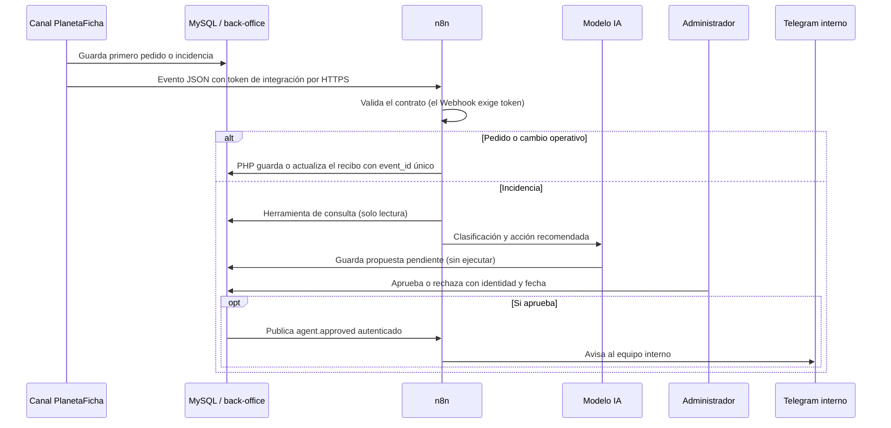

# README de la Tarea 2 — PlanetaFicha

Esta entrega amplía el canal digital de la Tarea 1 con integración de eventos mediante n8n, tres payloads de escenario, registros idempotentes de ejecución, propuestas de IA con supervisión humana, aviso interno por Telegram y cuadro de mando conectado a los datos de MySQL.

> Prototipo académico. Usa cuentas, mensajes y datos ficticios. Nunca subas credenciales, tokens, claves privadas ni datos personales reales.

## Contenido

- `workflows/planetaficha-tarea2.json`: webhook con autenticación por cabecera, validación de contrato y rutas de pedido/cambio/incidencia, AI Agent con herramientas y Telegram tras aprobación humana.
- `workflows/planetaficha-tarea2-errors.json`: captura y persistencia de errores de ejecución.
- `payloads/`: ejemplos de los tres escenarios.
- `CONTRATO.md`: esquema JSON, validaciones e idempotencia.
- `dashboard.html`: métricas operativas y bandeja de revisión de propuestas.
- `send-payload.mjs`: emisor de pruebas que usa la credencial de integración del webhook.
- `evidence/`: carpeta para evidencias reales que genere el equipo.
- `entregables/Memoria_Tarea_2_PlanetaFicha_VersionReal.pdf`: memoria de 10 páginas; la última página actualiza el alcance para PayPal Sandbox.
- `entregables/Presentacion_Tarea_2_PlanetaFicha_VersionReal.pptx`: presentación editable de 5 diapositivas actualizada para esta versión.
- `entregables/VersionFinalReal_Tarea2.zip`: paquete del proyecto sin archivos de configuración privada.

## Arquitectura



La base de PlanetaFicha es el back-office; `integracion_ejecuciones` registra la recepción, resultado e ID de ejecución de n8n. `event_id` tiene restricción única para no duplicar el recibo si se reintenta un evento.

## Escenarios

1. **Pedido integrado:** tras persistir pedido, líneas y eventos, PHP publica `order.created`. El flujo cubre los métodos simulados y la captura de PayPal Sandbox. n8n valida y guarda el recibo de integración.
2. **Cambio operativo:** un administrador cambia el estado desde el cuadro de mando. PHP guarda el nuevo estado, registra `order.status_changed` y lo publica a n8n.
3. **Incidencia postventa:** PHP guarda y publica `support.requested`. El agente consulta incidencia e historial de pedidos, propone una acción estructurada y la deja pendiente. El administrador decide. Solo tras aprobar, n8n envía aviso al grupo interno de Telegram.

El agente no cierra incidencias, cambia pedidos ni escribe al cliente. La notificación es interna. Si falla el modelo, PHP, autenticación o Telegram, n8n conserva la ejecución de error y el workflow de errores intenta registrarla en PlanetaFicha.

## Instalación

1. Si aún no existe, importa `database/juegos_y_puzles.sql`.
2. Ejecuta una sola vez `database/migrations/001_tarea2_integration.sql` sobre la base existente. Amplía el enum de eventos y añade las tablas de ejecución y propuesta.
3. Importa en n8n los dos JSON de `workflows/`.
4. Crea en n8n una credencial de OpenAI de pruebas y una credencial de Telegram para un grupo interno.
5. Configura variables de entorno de n8n:
   - `PF_API_BASE_URL`: origen HTTPS del sitio, sin `/` final.
   - `PF_INTEGRATION_TOKEN`: mismo secreto fuerte que `integration.shared_secret` en PHP.
   - El mismo valor de `integration.shared_secret` se guarda en la credencial Header Auth del Webhook n8n con nombre de cabecera `X-Integration-Token`.
   - `PF_TELEGRAM_SUPPORT_CHAT_ID`: chat interno del equipo.

6. En `api/config/config.php` privado, añade la sección `integration` de `api/config/config.example.php`; establece `event_webhook_url` con la Production URL del Webhook de n8n y un secreto aleatorio de al menos 32 bytes. No compartas ese archivo.
7. En n8n selecciona las credenciales, usa las Production URLs, guarda y activa los workflows. Asocia el workflow de errores como manejador de errores de la instancia/workflow.
8. Inicia sesión como administrador y abre **Back-office → Cuadro operativo de la Tarea 2**. Comprueba que `/api/health.php` responde correctamente.

El evento `agent.approved` reutiliza el Webhook principal. El archivo de configuración real permanece privado y no forma parte de esta entrega.

## Enviar payloads de prueba

Define temporalmente `PF_N8N_WEBHOOK_URL` y `PF_INTEGRATION_TOKEN` en el terminal con la Production URL y el secreto de prueba. Desde la raíz del proyecto:

```powershell
node tarea2/send-payload.mjs tarea2/payloads/01-pedido-integrado.json
node tarea2/send-payload.mjs tarea2/payloads/02-cambio-estado.json
node tarea2/send-payload.mjs tarea2/payloads/03-incidencia-supervisada.json
```

Los dos primeros payloads de muestra registran ejecuciones de integración, no crean pedidos reales. La muestra de incidencia requiere que exista la incidencia ficticia `1`; para probar el flujo completo, envía una incidencia desde la interfaz y usa su evento real.

## Métricas

El cuadro consulta las tablas de pedidos, líneas, productos, incidencias, eventos, integraciones y propuestas. Incluye pedidos, facturación simulada, productos más pedidos, pedidos por estado, incidencias abiertas, tiempo medio resuelto, ejecuciones correctas/fallidas, conversión de checkout a pedido, propuestas pendientes/aprobadas y un gráfico de pedidos por día. Si no hay denominador o datos resueltos, muestra “Sin datos”; no se usa CSV de cifras inventadas.

Se eligieron métricas que miden volumen y valor del proceso, demanda de productos, carga por estado, atención al cliente, conversión y fiabilidad del flujo. La conversión se define como pedidos creados dividido por checkouts iniciados; el histórico puede superar 100% si los eventos consultados no comparten ventana o si una ejecución se repite, por lo que es solo un indicador didáctico.

## IA agéntica y control humano

El nodo **AI Agent / Tools Agent** tiene dos herramientas: consulta HTTP de solo lectura para recuperar el incidente y hasta cinco pedidos del mismo usuario; y API HTTP para guardar una propuesta estructurada con `caseType`, `consultedData`, `proposedAction`, `rationale`, `confidence`, `priority` y `risks`. La propuesta permanece en `pendiente_revision`. La acción externa (Telegram interno) solo se activa cuando un administrador la aprueba. Aprobar y rechazar queda guardado con usuario y fecha.

Riesgos: el modelo puede equivocarse; el texto de incidencia es entrada no confiable; el proveedor de IA recibe el contenido enviado. Usa datos ficticios, revisa permisos y retención del proveedor, y no configures secretos reales de producción en la entrega.

## Matriz de decisión

Escala 1 (débil) a 5 (fuerte), pesos estimados para una pequeña empresa académica que ya mantiene el canal. El equipo debe ajustar los costes a ofertas y condiciones reales antes de recomendar una compra.

| Criterio | Peso | PHP + n8n | SaaS no-code | ERP/CRM configurable |
| --- | ---: | ---: | ---: | ---: |
| Funcionalidad para el caso | 15% | 4 | 3 | 5 |
| Coste inicial estimado | 10% | 4 | 3 | 2 |
| Esfuerzo de implantación | 10% | 3 | 5 | 2 |
| Escalabilidad | 10% | 4 | 3 | 5 |
| Integración con el proyecto | 12% | 5 | 3 | 4 |
| Seguridad y control de datos | 12% | 4 | 2 | 4 |
| Dependencia del proveedor | 7% | 4 | 1 | 2 |
| Mantenimiento | 7% | 3 | 4 | 2 |
| Trazabilidad y revisión | 10% | 5 | 3 | 4 |
| Adecuación a empresa pequeña | 7% | 4 | 4 | 2 |
| **Puntuación ponderada / 5** | **100%** | **4,05** | **3,08** | **3,43** |

Se recomienda la arquitectura híbrida PHP + MySQL + n8n porque reutiliza la aplicación y permite pasos programados, trazabilidad y control humano. La matriz es una valoración académica, no un estudio de mercado.

## Evidencias que debe generar el grupo

La memoria y la presentación incluidas están adaptadas a VersionFinalReal; la memoria añade una actualización sobre PayPal Sandbox. El equipo debe personalizar nombres y datos del grupo y sustituir el estado de pruebas por evidencias reales. El equipo debe ejecutar n8n en su entorno antes de afirmar resultados. Después debe guardar en `evidence/` capturas/logs sin secretos de: pedido integrado antes/después; cambio de estado; incidencia y consulta de herramienta; salida estructurada de IA; aprobación y rechazo; notificación Telegram; y una rama de error. El grupo también debe crear o actualizar su repositorio GitHub con contribuciones auténticas y completar el anexo de IA con el modelo realmente usado.

No es posible activar servicios externos ni crear capturas de ejecuciones que todavía no han ocurrido. Esta carpeta trae código, exportaciones y guía para reproducirlos; el grupo debe importar, configurar, ejecutar y verificarlo en sus cuentas/hosting.

## Referencias técnicas

- [n8n AI Agent](https://docs.n8n.io/integrations/builtin/cluster-nodes/root-nodes/n8n-nodes-langchain.agent/): modelo y herramientas para un agente operativo.
- [n8n Tools Agent](https://docs.n8n.io/integrations/builtin/cluster-nodes/root-nodes/n8n-nodes-langchain.agent/tools-agent/): uso de herramientas y APIs desde el agente.
- [n8n HTTP Request](https://docs.n8n.io/integrations/builtin/core-nodes/n8n-nodes-base.httprequest/): integración mediante REST y uso como herramienta.
- [Google SRE Workbook: Alerting on SLOs](https://sre.google/workbook/alerting-on-slos/): señales de fiabilidad y errores para seguimiento operativo.


Nota: PHP espera solo la confirmación rápida de recepción del Webhook (workflowAccepted). La ejecución completa, el resultado y los errores se verifican en n8n y en el cuadro operativo; la respuesta de aceptación no significa que el flujo haya terminado.


